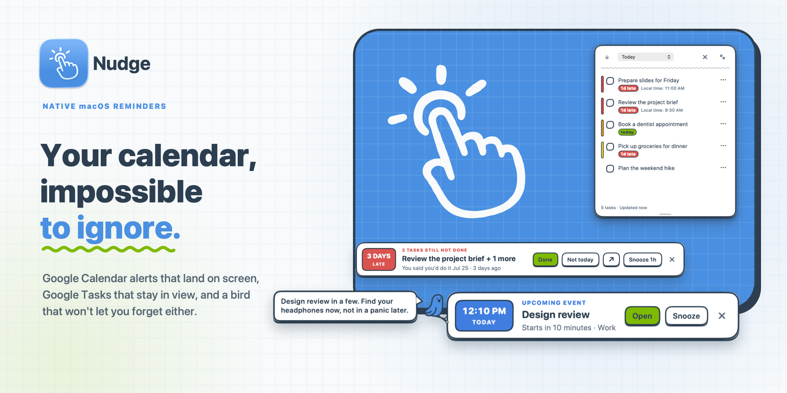
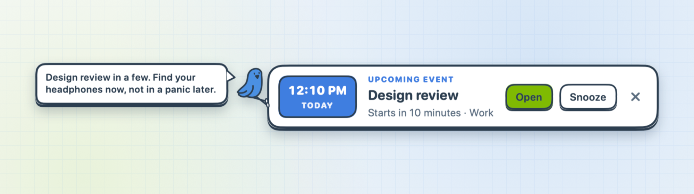
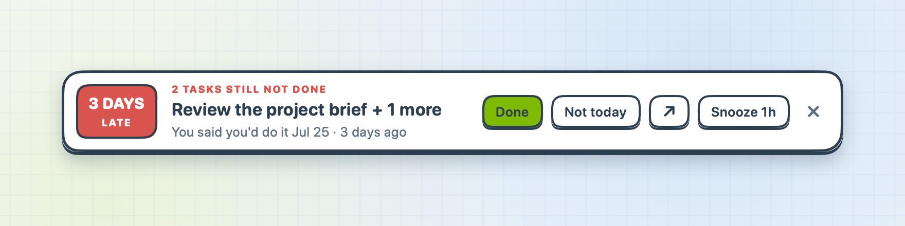
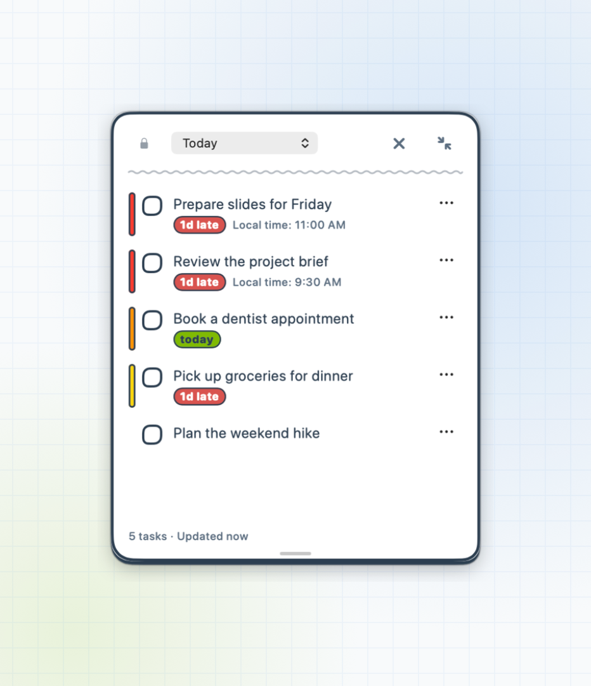
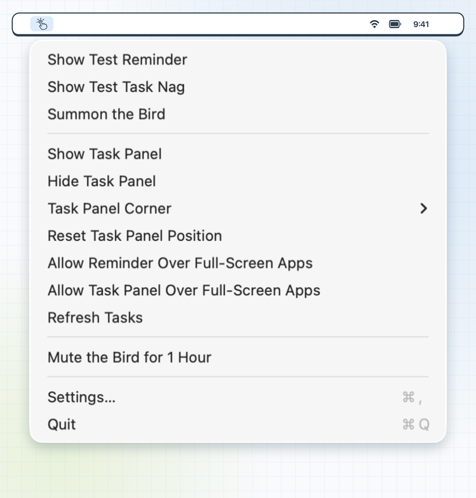
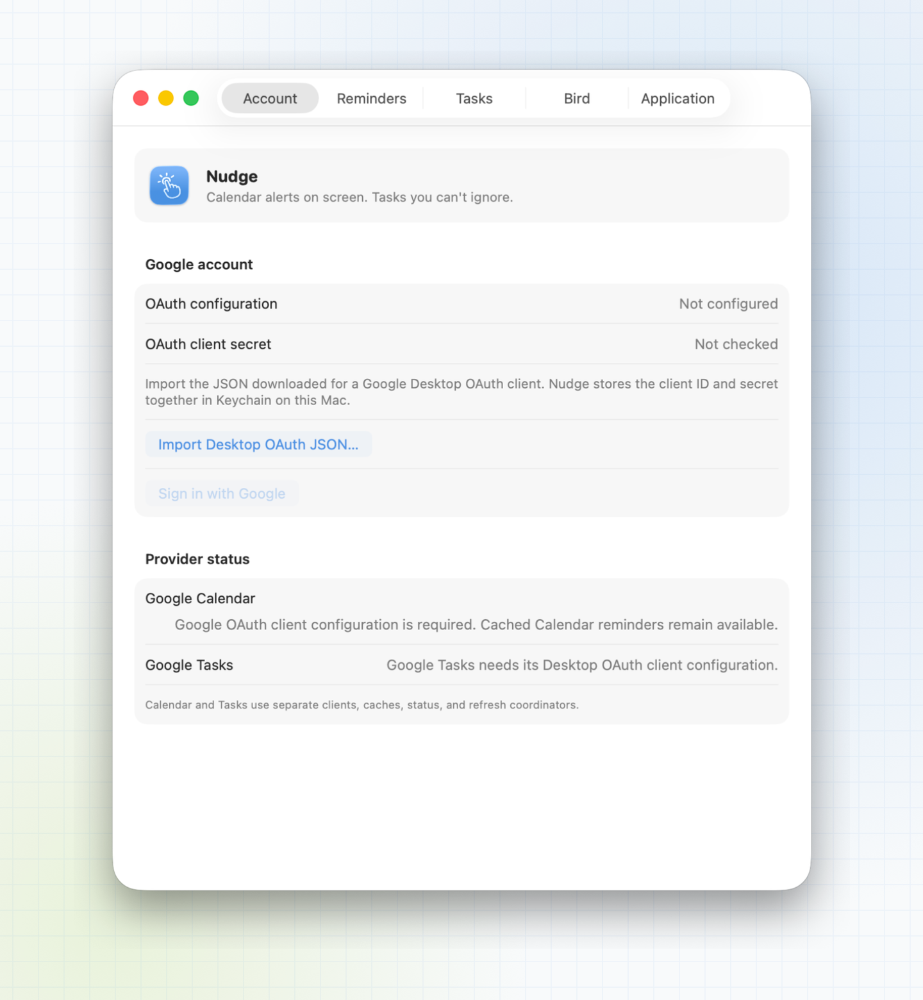
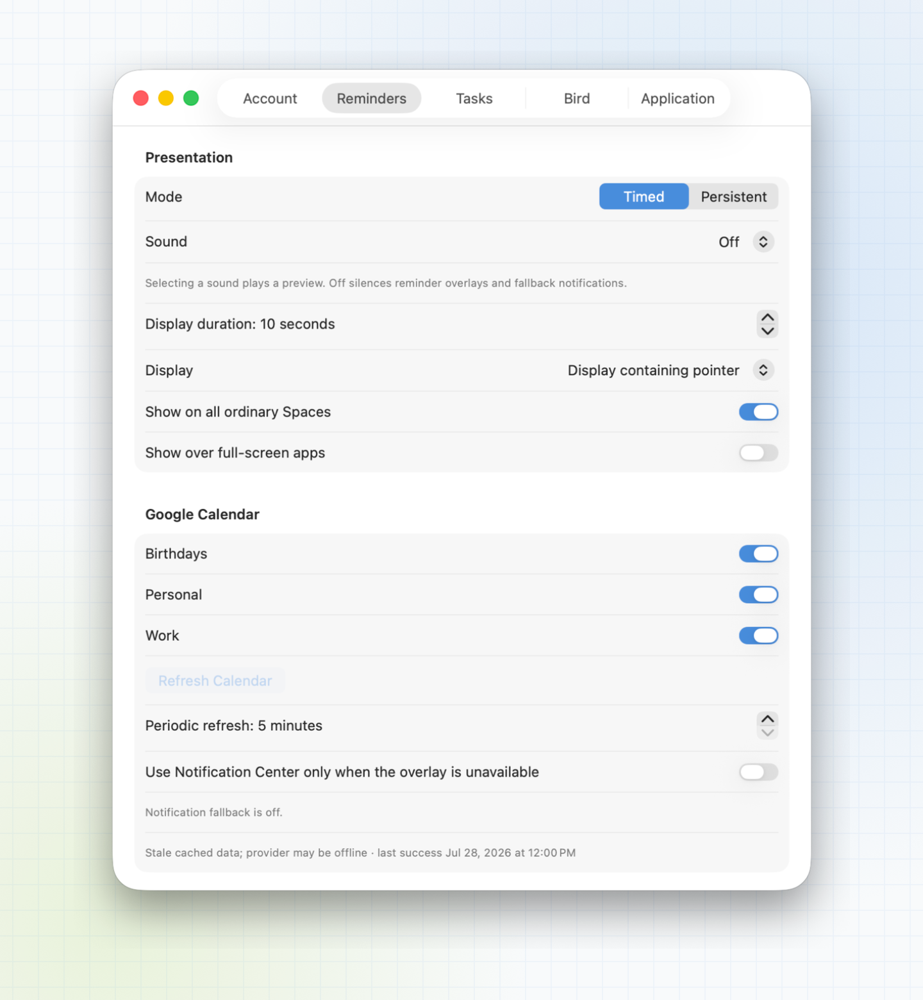
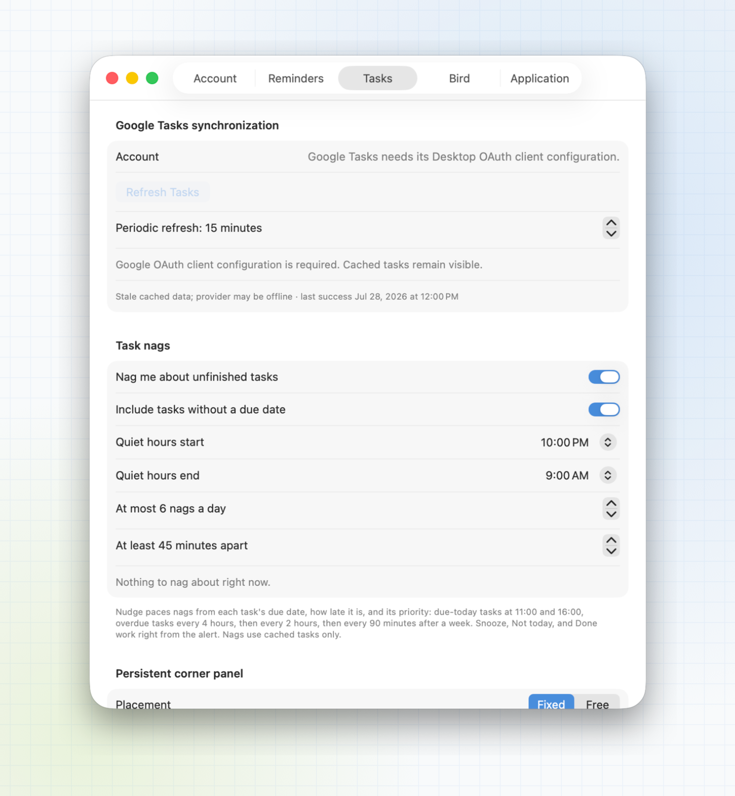
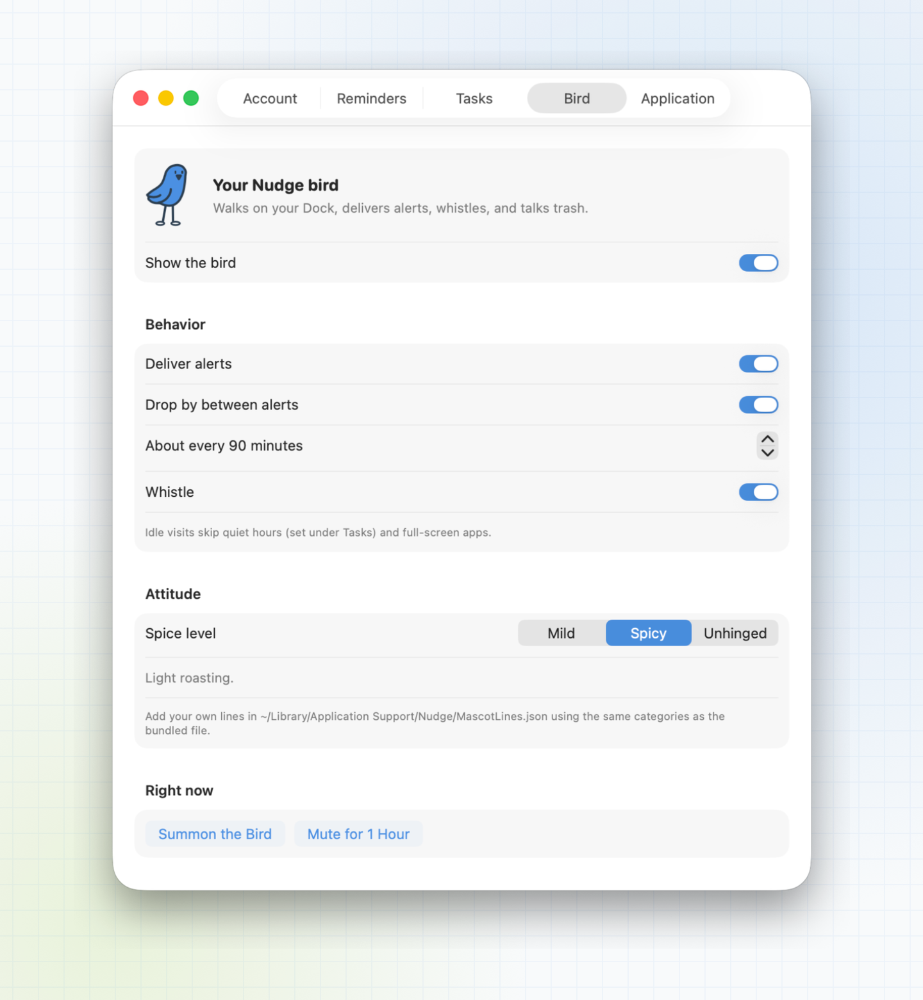
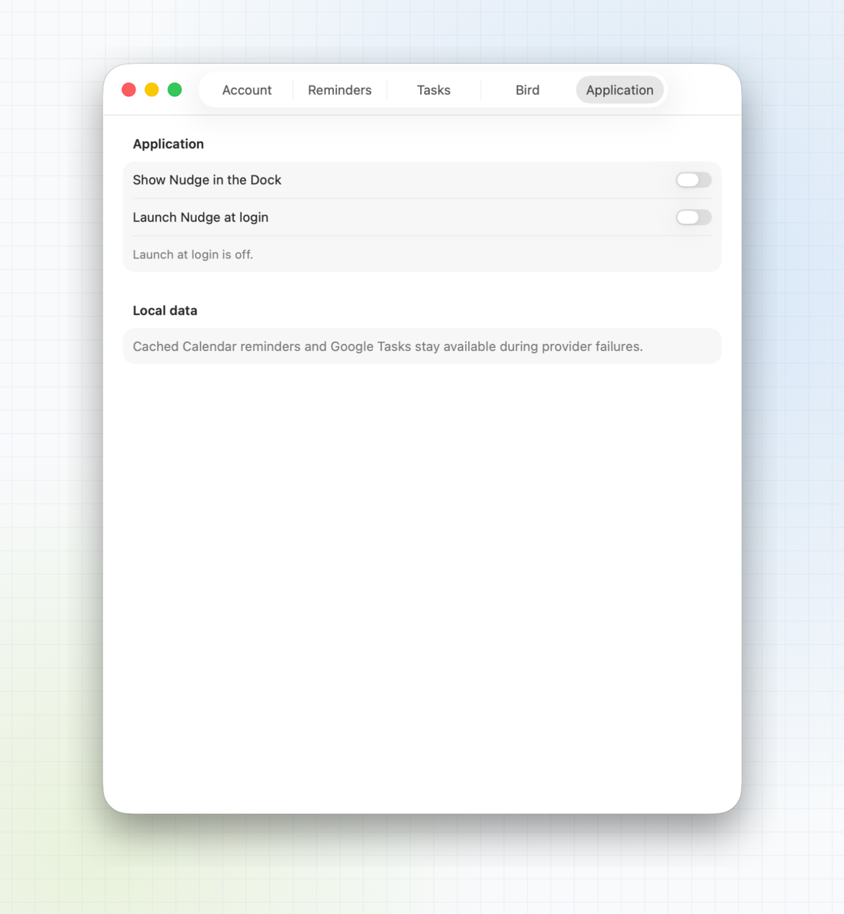

<p align="center">
  
</p>

<h1 align="center">Nudge</h1>

<p align="center">
  <strong>Your calendar, impossible to ignore.</strong><br>
  A native macOS menu-bar app that puts Google Calendar reminders directly on screen, keeps Google Tasks in view, and sends a small blue bird to make sure you noticed.
</p>

<p align="center">
  
</p>

Nudge is built with SwiftUI and AppKit for macOS 14 or later. Calendar reminders appear as an always-on-top alert instead of disappearing into Notification Center, unfinished Google Tasks get their own nags, and your open tasks can stay pinned in a corner of the screen.

## What it looks like

<p align="center">
  
  <br>
  <sub><b>Calendar alerts</b> land on top of every window. The bird flies in, perches on the alert, and comments.</sub>
</p>

<p align="center">
  
  <br>
  <sub><b>Task nags</b> chase overdue Google Tasks. Finish one right from the alert, or tell Nudge "Not today".</sub>
</p>

<table>
  <tr>
    <td align="center" width="50%">
      
      <br><sub><b>Tasks panel.</b> Your Google Tasks, always in view in a corner you choose.</sub>
    </td>
    <td align="center" width="50%">
      
      <br><sub><b>Menu bar.</b> Everything one click away, including summoning the bird.</sub>
    </td>
  </tr>
</table>

### Settings

<table>
  <tr>
    <td align="center" width="50%">
      
      <br><sub><b>Account.</b> Bring your own Google OAuth client and sign in.</sub>
    </td>
    <td align="center" width="50%">
      
      <br><sub><b>Reminders.</b> Calendars, timing, sound, displays, and Spaces.</sub>
    </td>
  </tr>
  <tr>
    <td align="center" width="50%">
      
      <br><sub><b>Tasks.</b> Sync, task nags, quiet hours, and the panel's look.</sub>
    </td>
    <td align="center" width="50%">
      
      <br><sub><b>Bird.</b> Alerts, idle visits, whistling, and how spicy it gets.</sub>
    </td>
  </tr>
  <tr>
    <td align="center" width="50%">
      
      <br><sub><b>Application.</b> Launch at login, Dock icon, and local data.</sub>
    </td>
    <td width="50%"></td>
  </tr>
</table>

## Features

- **On-screen Google Calendar alerts** that float above ordinary windows, with open, snooze, and dismiss, plus sound, display, Spaces, and full-screen controls.
- **Task nags** for overdue or forgotten Google Tasks, built from the local cache. Mark a task done from the alert, snooze it for an hour, or choose **Not today**. Nags respect your quiet hours.
- **A persistent Google Tasks panel** with list filtering, local priorities, completion, snooze, fixed corners, free placement, resizing, and configurable appearance.
- **The Nudge bird**, an optional animated mascot. It perches on alerts, walks along your Dock between them, whistles, and roasts you at a Mild, Spicy, or Unhinged level. You can add your own lines.
- **Sessions that stay signed in.** If Google does sign Nudge out, an on-screen alert explains why and offers a one-click **Sign in** button.
- Independent Calendar and Tasks synchronization with cached offline data and bounded periodic refreshes.
- Launch at login (turned on once automatically for installed copies), an optional Notification Center fallback, and an optional Dock icon.
- Native universal support for Apple silicon and Intel Macs.
- No backend, analytics service, Electron runtime, Apple Calendar access, or third-party dependency.

## Download and install

1. Download `Nudge-v0.1.0.zip` and its `.sha256` file from the [latest GitHub release](https://github.com/Henriqueprodr/Nudge/releases/latest).
2. Optionally verify the download in Terminal from the folder containing both files:

   ```sh
   shasum -a 256 -c Nudge-v0.1.0.zip.sha256
   ```

3. Open the ZIP and move `Nudge.app` to `/Applications`.
4. Control-click `Nudge.app`, choose **Open**, then confirm **Open**. If macOS does not offer that choice, open **System Settings → Privacy & Security** and choose **Open Anyway** for Nudge.

The 0.1.0 download is ad-hoc signed, not Developer ID signed or notarized. Gatekeeper therefore cannot identify its developer and requires the manual approval above. Do not disable Gatekeeper or remove quarantine globally; download Nudge only from this repository and verify its checksum if you want an additional integrity check. Apple describes Developer ID and notarization as the normal path for apps distributed outside the Mac App Store in its [macOS distribution guidance](https://developer.apple.com/macos/distribution/).

Nudge appears in the menu bar rather than opening a normal app window. Choose **Settings** from its menu to configure it.

## Connect your Google account

The public Nudge download contains no Google OAuth client ID or client secret. Each user supplies a Desktop OAuth credential from a Google Cloud project they control.

1. Create or select a project in [Google Cloud Console](https://console.cloud.google.com/).
2. Enable both the [Google Calendar API](https://console.cloud.google.com/apis/library/calendar-json.googleapis.com) and [Google Tasks API](https://console.cloud.google.com/apis/library/tasks.googleapis.com).
3. Configure the Google Auth Platform consent screen and audience.
4. Create an OAuth client with application type **Desktop app**, then download its JSON file. Google documents this under [Create access credentials](https://developers.google.com/workspace/guides/create-credentials#desktop-app).
5. In Nudge, open **Settings → Account → Import Desktop OAuth JSON…** and select the downloaded file.
6. Choose **Sign in with Google** and approve the requested Calendar and Tasks access.

Nudge requests read-only Calendar-list and Calendar-event access plus Google Tasks access so it can display and complete tasks. It uses the system browser, a local loopback callback, and PKCE for sign-in.

Google projects left in **Testing** allow only listed test users, and authorizations involving these scopes expire after seven days. For persistent personal use, the project can be moved to **In production**; an unverified personal-use app can show a warning that the user must explicitly continue through. See Google's [audience guidance](https://support.google.com/cloud/answer/15549945) and [personal-use verification exemption](https://support.google.com/cloud/answer/13464323).

After a successful import, Nudge stores the client configuration and Google account tokens in macOS Keychain. It does not copy the selected JSON file.

## Use Nudge

- **Calendar reminders:** choose calendars, reminder timing, sounds, display behavior, Spaces, and optional Notification Center fallback in **Settings → Reminders**.
- **Google Tasks:** show or hide the corner panel from the menu bar, then configure its task list, refresh interval, placement, size, opacity, and priority colors in **Settings → Tasks**.
- **Task nags:** turn on **Nag me about unfinished tasks** and set quiet hours in **Settings → Tasks**. Optionally include tasks without a due date.
- **The bird:** turn it on or off, choose whether it delivers alerts or drops by between them, and pick its spice level in **Settings → Bird**. Summon or mute it from the menu bar. Add your own lines in `~/Library/Application Support/Nudge/MascotLines.json`, using the same categories as the bundled file.
- **Application:** configure launch at login and whether Nudge also appears in the Dock under **Settings → Application**.

Calendar refresh defaults to five minutes and Tasks refresh defaults to fifteen minutes. Nudge also refreshes after sign-in, wake, manual requests, relevant settings changes, and task actions; it does not poll Google every second.

## Privacy and security

- Nudge talks directly to Google's OAuth, Calendar, and Tasks endpoints. There is no Nudge server or analytics service.
- OAuth client configuration and account tokens are stored in Keychain. Calendar and task caches and presentation settings remain on the Mac.
- Cached data stays visible during temporary network or Google API failures.
- Nudge never reads Apple Calendar or requests EventKit permission.
- The public source, build, and ZIP are checked for embedded Google client values before release.

Disconnect the Google account in Nudge to remove its stored account token. You can separately remove an imported OAuth configuration while signed out.

## Build from source

Requirements:

- macOS 14 or later
- Xcode 26 or later with the macOS SDK and command-line tools

Clone and build the credential-free app:

```sh
git clone https://github.com/Henriqueprodr/Nudge.git
cd Nudge
xcodebuild -project Nudge.xcodeproj -scheme Nudge -configuration Debug -derivedDataPath .build/DerivedData build
open .build/DerivedData/Build/Products/Debug/Nudge.app
```

Then import your Desktop OAuth JSON from Nudge's Account settings. Run the unit tests with:

```sh
xcodebuild -project Nudge.xcodeproj -scheme Nudge -configuration Debug -derivedDataPath .build/DerivedData test
```

Regenerate the credential-free screenshot gallery with:

```sh
./script/capture_screenshots.sh
```

The script builds with empty Google OAuth values and launches only the Debug-only, in-memory screenshot mode. It presents Nudge's real AppKit windows and native menu, including the bird perched on an alert and a task nag. It captures only Nudge-owned surfaces through ScreenCaptureKit and composites them over the same paper-and-grid artwork used by the hero. macOS requires one-time **Screen & System Audio Recording** approval for the development-signed Nudge capture app; no desktop or other-app pixels are included. The ten checked-in PNGs are replaced only after every native capture and composition succeeds.

Regenerate the README icon, hero, and GitHub social-preview artwork with:

```sh
./script/generate_readme_assets.sh
```

This dependency-free generator renders the shipped `AppIcon.icon` with Xcode's Icon Composer tool, then uses AppKit and Core Graphics to lay out the hero from the transparent native captures. Run `capture_screenshots.sh` first. It writes the finished assets under `docs/assets/` without reading application data.

Create the public credential-free release artifact with:

```sh
./script/package_release.sh --public --no-launch
```

## License

Nudge is available under the [MIT License](LICENSE).
