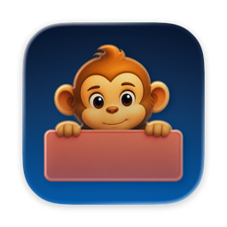

<p align="center">
  
</p>

<h1 align="center">Nudge</h1>

<p align="center">
  A native macOS menu-bar app that puts Google Calendar reminders directly on screen and keeps Google Tasks within reach.
</p>

Nudge is built with SwiftUI and AppKit for macOS 14 or later. Calendar reminders appear in an always-on-top control strip instead of disappearing into Notification Center, while incomplete Google Tasks can remain visible in a configurable corner panel.

## Features

- Direct on-screen Google Calendar reminder overlays with dismiss, snooze, open, sound, display, Spaces, and full-screen controls.
- A persistent Google Tasks panel with list filtering, local priorities, completion, snooze, fixed corners, free placement, resizing, and configurable appearance.
- Independent Calendar and Tasks synchronization with cached offline data and bounded periodic refreshes.
- Optional Notification Center fallback, launch at login, and Dock icon.
- Native universal support for Apple silicon and Intel Macs.
- No backend, analytics service, Electron runtime, Apple Calendar access, or third-party dependency.

## Download and install

1. Download `Nudge-v0.1.0.zip` and its `.sha256` file from the [latest GitHub release](https://github.com/Henriqueprodr/Nudge/releases/latest).
2. Optionally verify the download in Terminal from the folder containing both files:

   ```sh
   shasum -a 256 -c Nudge-v0.1.0.zip.sha256
   ```

3. Open the ZIP and move `Nudge.app` to `/Applications`.
4. Control-click `Nudge.app`, choose **Open**, then confirm **Open**. If macOS does not offer that choice, open **System Settings → Privacy & Security** and choose **Open Anyway** for Nudge.

The 0.1.0 download is ad-hoc signed, not Developer ID signed or notarized. Gatekeeper therefore cannot identify its developer and requires the manual approval above. Do not disable Gatekeeper or remove quarantine globally; download Nudge only from this repository and verify its checksum if you want an additional integrity check. Apple describes Developer ID and notarization as the normal path for apps distributed outside the Mac App Store in its [macOS distribution guidance](https://developer.apple.com/macos/distribution/).

Nudge appears in the menu bar rather than opening a normal app window. Choose **Settings** from its menu to configure it.

## Connect your Google account

The public Nudge download contains no Google OAuth client ID or client secret. Each user supplies a Desktop OAuth credential from a Google Cloud project they control.

1. Create or select a project in [Google Cloud Console](https://console.cloud.google.com/).
2. Enable both the [Google Calendar API](https://console.cloud.google.com/apis/library/calendar-json.googleapis.com) and [Google Tasks API](https://console.cloud.google.com/apis/library/tasks.googleapis.com).
3. Configure the Google Auth Platform consent screen and audience.
4. Create an OAuth client with application type **Desktop app**, then download its JSON file. Google documents this under [Create access credentials](https://developers.google.com/workspace/guides/create-credentials#desktop-app).
5. In Nudge, open **Settings → Account → Import Desktop OAuth JSON…** and select the downloaded file.
6. Choose **Sign in with Google** and approve the requested Calendar and Tasks access.

Nudge requests read-only Calendar-list and Calendar-event access plus Google Tasks access so it can display and complete tasks. It uses the system browser, a local loopback callback, and PKCE for sign-in.

Google projects left in **Testing** allow only listed test users, and authorizations involving these scopes expire after seven days. For persistent personal use, the project can be moved to **In production**; an unverified personal-use app can show a warning that the user must explicitly continue through. See Google's [audience guidance](https://support.google.com/cloud/answer/15549945) and [personal-use verification exemption](https://support.google.com/cloud/answer/13464323).

After a successful import, Nudge stores the client configuration and Google account tokens in macOS Keychain. It does not copy the selected JSON file.

## Use Nudge

- **Calendar reminders:** choose calendars, reminder timing, sounds, display behavior, Spaces, and optional Notification Center fallback in **Settings → Reminders**.
- **Google Tasks:** show or hide the corner panel from the menu bar, then configure its task list, refresh interval, placement, size, opacity, and priority colors in **Settings → Tasks**.
- **Application:** configure launch at login and whether Nudge also appears in the Dock under **Settings → Application**.

Calendar refresh defaults to five minutes and Tasks refresh defaults to fifteen minutes. Nudge also refreshes after sign-in, wake, manual requests, relevant settings changes, and task actions; it does not poll Google every second.

## Privacy and security

- Nudge talks directly to Google's OAuth, Calendar, and Tasks endpoints. There is no Nudge server or analytics service.
- OAuth client configuration and account tokens are stored in Keychain. Calendar and task caches and presentation settings remain on the Mac.
- Cached data stays visible during temporary network or Google API failures.
- Nudge never reads Apple Calendar or requests EventKit permission.
- The public source, build, and ZIP are checked for embedded Google client values before release.

Disconnect the Google account in Nudge to remove its stored account token. You can separately remove an imported OAuth configuration while signed out.

## Build from source

Requirements:

- macOS 14 or later
- Xcode 26 or later with the macOS SDK and command-line tools

Clone and build the credential-free app:

```sh
git clone https://github.com/Henriqueprodr/Nudge.git
cd Nudge
xcodebuild -project Nudge.xcodeproj -scheme Nudge -configuration Debug -derivedDataPath .build/DerivedData build
open .build/DerivedData/Build/Products/Debug/Nudge.app
```

Then import your Desktop OAuth JSON from Nudge's Account settings. Run the unit tests with:

```sh
xcodebuild -project Nudge.xcodeproj -scheme Nudge -configuration Debug -derivedDataPath .build/DerivedData test
```

Create the public credential-free release artifact with:

```sh
./script/package_release.sh --public --no-launch
```


## License

Nudge is available under the [MIT License](LICENSE).
